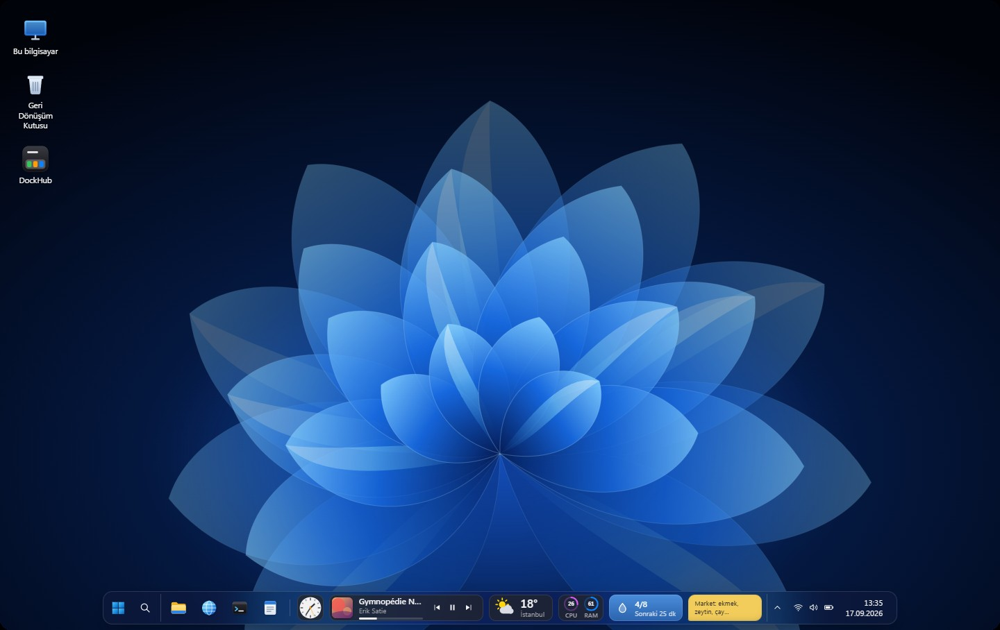
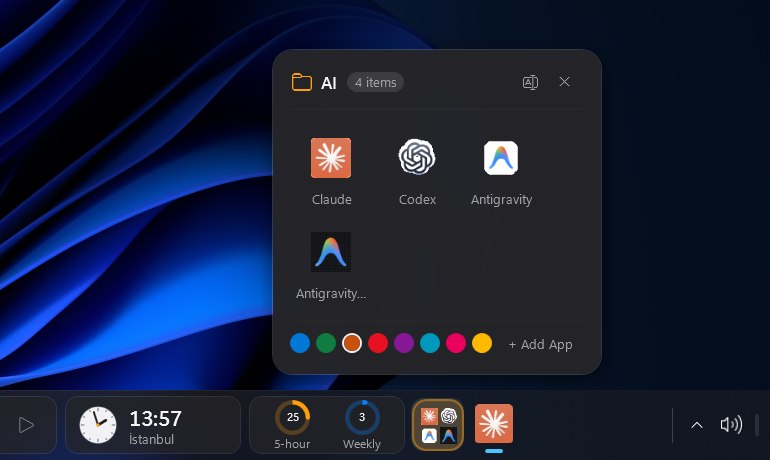
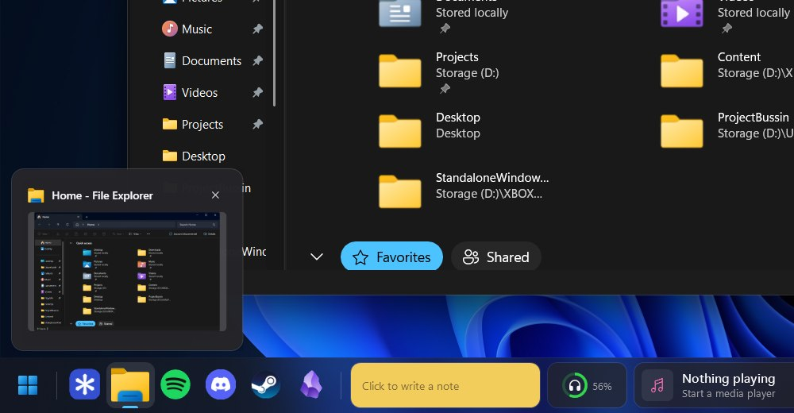
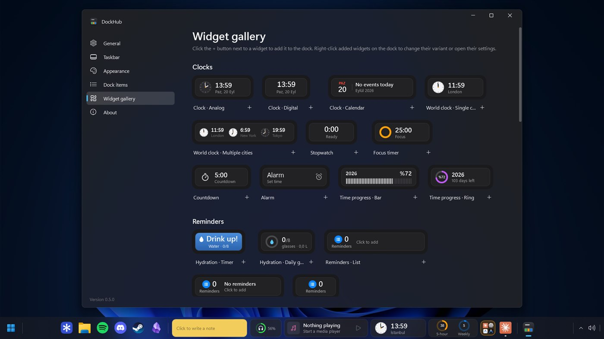
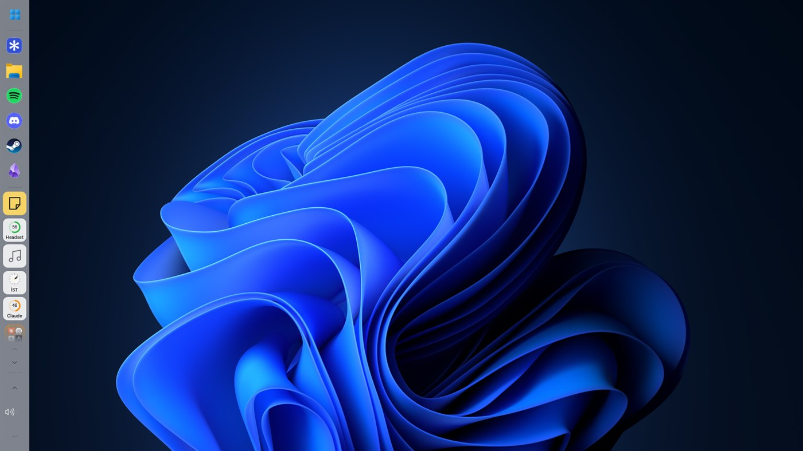

<div align="center">

<picture>
  <source media="(prefers-color-scheme: dark)" srcset="docs/images/logo-dark.png">
  <source media="(prefers-color-scheme: light)" srcset="docs/images/logo-light.png">
  
</picture>

**A modern, glassy dock for Windows and macOS.**<br>
Start menu, running apps, tray and 30+ live widgets in one floating dock. No admin rights needed.

[](https://github.com/sametgurtuna/DockHub/releases/latest)
[](#install)
[](#install)
[](https://github.com/sametgurtuna/DockHub/actions/workflows/ci.yml)
[](https://github.com/sametgurtuna/DockHub/actions/workflows/macos.yml)

[**Download**](https://github.com/sametgurtuna/DockHub/releases/latest) · [**Live demo**](https://sametgurtuna.github.io/dockhub-website/) · [**Widgets**](docs/widgets.md) · [**Docs**](#documentation)



</div>

## Why DockHub

- **Replaces the taskbar, keeps Windows intact.** The Start button opens the real Start menu; the Windows key, search and notification center work as before.
- **32 widgets.** Clocks, calendar, to-do, clipboard history, media, CPU/GPU/network, device batteries, AI usage, weather and more. Add any widget as many times as you like. [Full list →](docs/widgets.md)
- **Live app buttons.** Window thumbnails, Jump Lists, badges, progress, and folders by drag and drop.
- **Any edge, any look.** Bottom, top or sides; floating or attached; glass, Acrylic or solid; light and dark.
- **Build your own widgets** in HTML, CSS and JavaScript.
- **Safe by design.** If DockHub exits or crashes, the Windows taskbar comes back.
- **Keyboard first.** Win+1…9 switch apps, Win+Alt+Space opens the quick launcher.
- **In your language:** English, Turkish, German and Spanish.

<table>
  <tr>
    <td width="50%"><br><sub><b>Folders.</b> Drag apps together, click to fan them out.</sub></td>
    <td width="50%"><br><sub><b>Live previews.</b> Hover a running app for a real thumbnail.</sub></td>
  </tr>
  <tr>
    <td width="50%"><br><sub><b>Widget gallery.</b> Live previews, one click to add.</sub></td>
    <td width="50%"><br><sub><b>Vertical dock.</b> Widgets turn into compact tiles.</sub></td>
  </tr>
</table>

## Install

**Windows 10 (1809+) or 11**, x64 or ARM64

Download `DockHub-Setup-1.0.0-x64.exe` (or `-arm64.exe`) from the [latest release](https://github.com/sametgurtuna/DockHub/releases/latest), or:

```powershell
winget install SametGurtuna.DockHub
```

The installer is per-user, bundles the .NET 10 runtime and starts DockHub with Windows (you can turn that off).

**macOS 15 Sequoia or newer**, Apple Silicon or Intel

Download `DockHub-1.0.0.dmg`, drag **DockHub.app** to Applications and launch it. DockHub can hide the native Dock while it runs (*Settings › General*).

> [!TIP]
> **Taskbar missing?** Run `DockHub.exe --restore-taskbar` or use *Settings › General › Restore the Windows taskbar*. Don't run DockHub together with StartAllBack, ExplorerPatcher or RetroBar.

## Build from source

```powershell
# Windows: .NET 10 SDK
git clone https://github.com/sametgurtuna/DockHub.git
cd DockHub
dotnet run --project src/CustomDock -c Release
```

```bash
# macOS: Xcode 16 / Swift 6
cd macos && swift build -c release && .build/release/DockHub
```

Tests, the installer, DMG packaging and writing native widgets are covered in [docs/development.md](docs/development.md).

## Web widgets

Write a widget in HTML and JavaScript, pack it as a `.dockwidget` file and share it. Widgets use the stable `window.dockhub` API (SDK 1.0), follow the dock theme and can only reach the hosts they declare. See the [Widget SDK guide](docs/widget-sdk.md) and the [samples](samples/widgets). Community widgets can be added to the in-app gallery with a pull request.

## Privacy

No account and no telemetry. DockHub only goes online for the widgets you add (weather, exchange rates, stocks and so on) and a daily update check you can turn off. [Full list of hosts →](docs/configuration.md#permissions-and-privacy)

## Documentation

- [Features](docs/features.md): everything the taskbar replacement and the dock can do
- [Widgets](docs/widgets.md): all 32 widgets and their layouts
- [How it works](docs/how-it-works.md): hiding and restoring the taskbar, crash recovery, performance, known limitations
- [Configuration](docs/configuration.md): command line, data files, `config.json`, sync, permissions
- [Development](docs/development.md): building, tests, project structure, native widgets
- [Widget SDK](docs/widget-sdk.md): HTML/JavaScript widgets

## Contributing

Bug reports, widget ideas and pull requests are welcome. For larger changes, please open an [issue](https://github.com/sametgurtuna/DockHub/issues) first. When reporting a bug, *Settings › About › Report a problem* fills in the details for you.

## License and credits

No license file yet; all rights reserved by the author.

Thanks to [@farukolmez22](https://github.com/farukolmez22) for testing and contributions to the macOS version. DockHub builds on [ManagedShell](https://github.com/cairoshell/ManagedShell) and techniques from [RetroBar](https://github.com/dremin/RetroBar) (both Apache-2.0), [Microsoft.Toolkit.Uwp.Notifications](https://github.com/CommunityToolkit/WindowsCommunityToolkit) (MIT), weather by [Open-Meteo](https://open-meteo.com/) (CC BY 4.0), and emoji data from [Unicode CLDR](https://cldr.unicode.org/) and [Emojibase](https://emojibase.dev/).

Windows is a trademark of Microsoft Corporation. DockHub is not affiliated with Microsoft.
